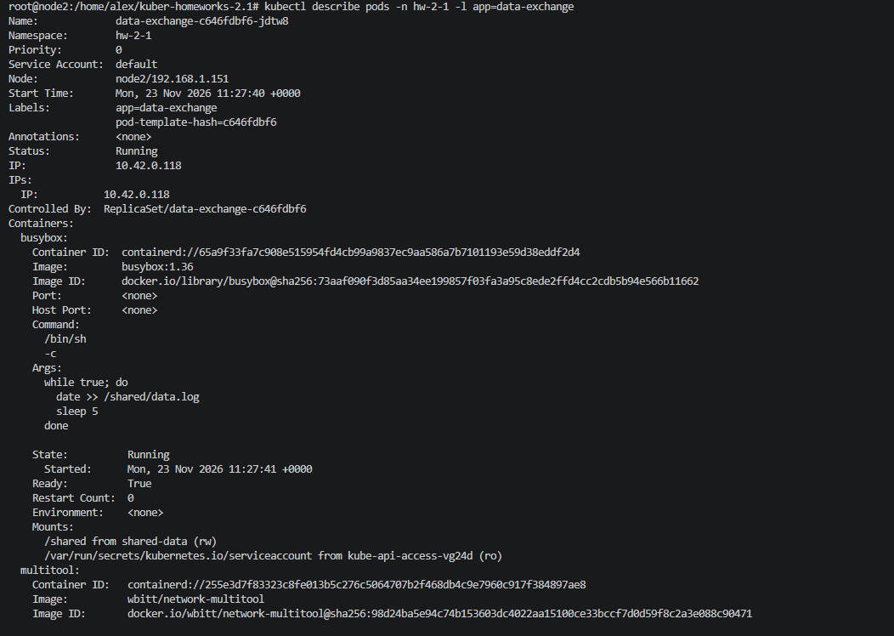
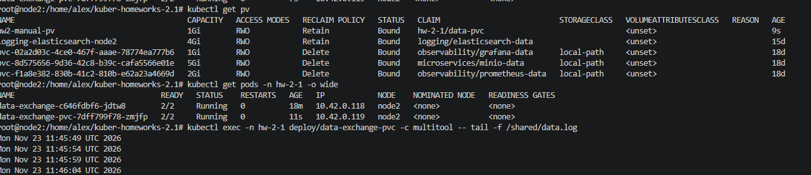
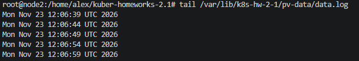
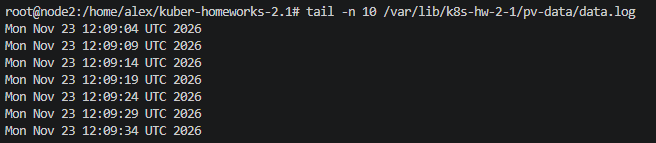
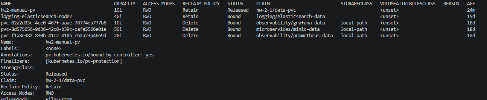
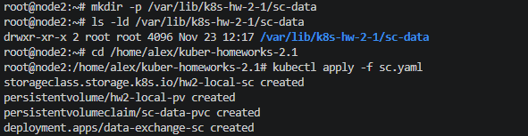
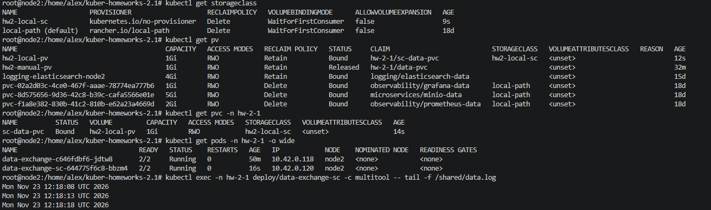

# Домашнее задание. Хранение в Kubernetes

## Задание 1. Volume: обмен данными между контейнерами в Pod

### Цель

Создать Deployment с двумя контейнерами, которые обмениваются данными через общий том "emptyDir".

### Реализация

Создан Deployment "data-exchange", содержащий два контейнера:

busybox - записывает текущую дату и время в файл "/shared/data.log" каждые 5 секунд.
multitool - предоставляет возможность прочитать содержимое файла из общей директории.

Для обмена данными мы возьмём Volume типо emptyDir под именем shared-data, который будет у нас монтировать оба контейнера по пути "/shared"

### Развёртывание

Создаём namespace, применяем манифест и проверяем состояние Pod:

```
root@node2:/home/alex/kuber-homeworks-2.1# kubectl create namespace hw-2-1 --dry-run=client -o yaml | kubectl apply -f -
kubectl apply -f containers-data-exchange.yaml
Warning: resource namespaces/hw-2-1 is missing the kubectl.kubernetes.io/last-applied-configuration annotation which is required by kubectl apply. kubectl apply should only be used on resources created declaratively by either kubectl create --save-config or kubectl apply. The missing annotation will be patched automatically.
namespace/hw-2-1 configured
deployment.apps/data-exchange created
root@node2:/home/alex/kuber-homeworks-2.1# kubectl get pods -n hw-2-1 -o wide
NAME                            READY   STATUS    RESTARTS   AGE   IP            NODE    NOMINATED NODE   READINESS GATES
data-exchange-c646fdbf6-jdtw8   2/2     Running   0          4s    10.42.0.118   node2   <none>           <none>
```

### Результат:

Deployment успешно создан, Pod находится в состоянии Running, оба контейнера работают (2/2).

### Проверка работы

Получено описание Pod:

```
root@node2:/home/alex/kuber-homeworks-2.1# kubectl describe pods -n hw-2-1 -l app=data-exchange
```

Скриншот:



Проверено чтение файла из контейнера multitool:

```
root@node2:/home/alex/kuber-homeworks-2.1# kubectl exec -n hw-2-1 deploy/data-exchange -c multitool -- tail -f /shared/data.log
Mon Nov 23 11:28:26 UTC 2026
Mon Nov 23 11:28:31 UTC 2026
Mon Nov 23 11:28:36 UTC 2026
```

В результате в терминале отображаются новые записи даты и времени каждые 5 секунд.

### Вывод:
В результате выполнения этого задания, мы настроили обмен между двумя контейнера одного Pod, 
с использованием emptyDir.

Контейнер busybox записывает данные в общую директорию, а multitool успешно читает их.

emptyDir существует в результате жизненного цикла пода.
При перезапуске отдельного контейнера данные сохраняются, но при удалении Pod и создании нового содержимое временного тома теряется.

## Задание 2. PersistentVolume и PVC

### Цель

Создать Deployment с двумя контейнерами, которые будут использовать хранилище на локальной ноде. Проверить сохранность данных после удаления или перезапуска ресурсов Kubernetes.

### Реализация

Создаём манифест pv-pvc.yaml по примеру из лекции.

PersistentVolume (PV) - постоянное хранилище объёмом 1GB
PersistentVolumeClaim (PVC) - Запрос на использование PV
Deployment - два наших контейнера Busybox и Multitool.

Характеристики хранилища:

Путь на сервере: /var/lib/k8s-hw-2-1/pv-data
Объём: 1GB

Контейнер busybox записывает текущую дату каждые 5 секунд в "/shared/data.log".

Контейнер "multitool" читает тот же файл через подключённый PVC.

### Создаём и проверяем ресурсы:

На сервере Ubuntu создан каталог:
```
mkdir -p /var/lib/k8s-hw-2-1/pv-data
```
Применяем манифест:

```
kubectl apply -f pv-pvc.yaml
```

Проверяем:

```
root@node2:/home/alex/kuber-homeworks-2.1# kubectl get pods -n hw-2-1 -o wide
NAME                                 READY   STATUS    RESTARTS   AGE   IP            NODE    NOMINATED NODE   READINESS GATES
data-exchange-c646fdbf6-jdtw8        2/2     Running   0          18m   10.42.0.118   node2   <none>           <none>
data-exchange-pvc-7dff799f78-zmjfp   2/2     Running   0          7s    10.42.0.119   node2   <none>           <none>
root@node2:/home/alex/kuber-homeworks-2.1# kubectl get pv
NAME                                       CAPACITY   ACCESS MODES   RECLAIM POLICY   STATUS   CLAIM                           STORAGECLASS   VOLUMEATTRIBUTESCLASS   REASON   AGE
hw2-manual-pv                              1Gi        RWO            Retain           Bound    hw-2-1/data-pvc                                <unset>                          9s
logging-elasticsearch-node2                4Gi        RWO            Retain           Bound    logging/elasticsearch-data                     <unset>                          15d
pvc-02a2d03c-4ce0-467f-aaae-78774ea777b6   1Gi        RWO            Delete           Bound    observability/grafana-data      local-path     <unset>                          18d
pvc-8d575656-9d36-42c8-b39c-cafa5566e01e   5Gi        RWO            Delete           Bound    microservices/minio-data        local-path     <unset>                          18d
pvc-f1a8e382-830b-41c2-810b-e62a23a4669d   2Gi        RWO            Delete           Bound    observability/prometheus-data   local-path     <unset>                          18d
root@node2:/home/alex/kuber-homeworks-2.1# kubectl get pods -n hw-2-1 -o wide
NAME                                 READY   STATUS    RESTARTS   AGE   IP            NODE    NOMINATED NODE   READINESS GATES
data-exchange-c646fdbf6-jdtw8        2/2     Running   0          18m   10.42.0.118   node2   <none>           <none>
data-exchange-pvc-7dff799f78-zmjfp   2/2     Running   0          11s   10.42.0.119   node2   <none>           <none>
root@node2:/home/alex/kuber-homeworks-2.1# kubectl exec -n hw-2-1 deploy/data-exchange-pvc -c multitool -- tail -f /shared/data.log
Mon Nov 23 11:45:49 UTC 2026
Mon Nov 23 11:45:54 UTC 2026
Mon Nov 23 11:45:59 UTC 2026
```

Pod "data-exchange-pvc" успешно запущен, оба контейнера находятся в состоянии `Running` (2/2).



### Проверка обмена данными

Выполнено чтение файла из контейнера multitool:

```
root@node2:/home/alex/kuber-homeworks-2.1# tail /var/lib/k8s-hw-2-1/pv-data/data.log
Mon Nov 23 11:45:49 UTC 2026
Mon Nov 23 11:45:54 UTC 2026
Mon Nov 23 11:45:59 UTC 2026
```

Файл выполняет запись каждые 5 секунд.

Дополнительно проверено содержимое файла непосредственно на ноде Kubernetes:



Результат: содержимое файла на физическом диске сервера совпадает с данными, полученными из контейнера.
Это подтверждает, что приложение использует локальное постоянное хранилище через PV и PVC.

### Проверяем сохранность данных после удаления 

Удаляем Deployment и PVC
PVC ресурс перешёл в состояние "Released"

Причина: для PV была настроена политика persistentVolumeReclaimPolicy: Retain. Kubernetes освобождает ресурс от привязки к PVC, но не удаляет данные.

Далее был удалён сам PersistentVolume и смотрим логи в локальном каталоге:

```
root@node2:/home/alex/kuber-homeworks-2.1# tail -n 10 /var/lib/k8s-hw-2-1/pv-data/data.log
Mon Nov 23 12:09:04 UTC 2026
Mon Nov 23 12:09:09 UTC 2026
Mon Nov 23 12:09:14 UTC 2026
Mon Nov 23 12:09:19 UTC 2026
```





### Вывод:

PersistentVolume и PersistentVolumeClaim позволяют отделить хранение данных от жизненного цикла Pod.

При использовании локального хранилища hostPath и политики Retain удаление PVC и PV не приводит к автоматическому удалению файлов на сервере.

Это позволяет сохранить данные приложения, однако управление их очисткой остаётся за администратором.

## Задание 3. StorageClass

### Цель.

Создать собственный StorageClass, PersistentVolumeClaim и Deployment с двумя контейнерами. Организовать обмен файлами через локальное постоянное хранилище Kubernetes.

### Реализация.

Создаём манифест sc.yaml, содержащий четыре ресурса:

StorageClass  — класс хранилища с ручным выделением томов.
PersistentVolume — локальный том размером 1 GiB.
PersistentVolumeClaim  — запрос на предоставление постоянного хранилища.
Deployment  — приложение с контейнерами busybox и multitool.

### Характеристика:

Объём: 1GB
Локальная директория: /var/lib/k8s-hw-2-1/sc-data

В качестве Provisioner используется kubernetes.io/no-provisioner. Автоматическое создание PV отсутствует, поэтому том был создан вручную.
Режим WaitForFirstConsumer откладывает привязку PVC до появления Pod, которому требуется хранилище.
Параметр nodeAffinity закрепляет PV за нодой node2, на которой расположена директория.

### Создание ресурсов:

На сервере создаём ресурс и манифест:

```
root@node2:~# mkdir -p /var/lib/k8s-hw-2-1/sc-data
root@node2:~# ls -ld /var/lib/k8s-hw-2-1/sc-data
drwxr-xr-x 2 root root 4096 Nov 23 12:17 /var/lib/k8s-hw-2-1/sc-data
root@node2:~# cd /home/alex/kuber-homeworks-2.1
root@node2:/home/alex/kuber-homeworks-2.1# kubectl apply -f sc.yaml
storageclass.storage.k8s.io/hw2-local-sc created
persistentvolume/hw2-local-pv created
persistentvolumeclaim/sc-data-pvc created
deployment.apps/data-exchange-sc created
```



Для проверки используем команды:

kubectl get storageclass
kubectl get pv
kubectl get pvc -n hw-2-1
kubectl get pods -n hw-2-1 -o wide

```
root@node2:/home/alex/kuber-homeworks-2.1# kubectl get storageclass
NAME                   PROVISIONER                    RECLAIMPOLICY   VOLUMEBINDINGMODE      ALLOWVOLUMEEXPANSION   AGE
hw2-local-sc           kubernetes.io/no-provisioner   Delete          WaitForFirstConsumer   false                  9s
local-path (default)   rancher.io/local-path          Delete          WaitForFirstConsumer   false                  18d
root@node2:/home/alex/kuber-homeworks-2.1# kubectl get pv
NAME                                       CAPACITY   ACCESS MODES   RECLAIM POLICY   STATUS     CLAIM                           STORAGECLASS   VOLUMEATTRIBUTESCLASS   REASON   AGE
hw2-local-pv                               1Gi        RWO            Retain           Bound      hw-2-1/sc-data-pvc              hw2-local-sc   <unset>                          12s
hw2-manual-pv                              1Gi        RWO            Retain           Released   hw-2-1/data-pvc                                <unset>                          32m
logging-elasticsearch-node2                4Gi        RWO            Retain           Bound      logging/elasticsearch-data                     <unset>                          15d
pvc-02a2d03c-4ce0-467f-aaae-78774ea777b6   1Gi        RWO            Delete           Bound      observability/grafana-data      local-path     <unset>                          18d
pvc-8d575656-9d36-42c8-b39c-cafa5566e01e   5Gi        RWO            Delete           Bound      microservices/minio-data        local-path     <unset>                          18d
pvc-f1a8e382-830b-41c2-810b-e62a23a4669d   2Gi        RWO            Delete           Bound      observability/prometheus-data   local-path     <unset>                          18d
root@node2:/home/alex/kuber-homeworks-2.1# kubectl get pvc -n hw-2-1
NAME          STATUS   VOLUME         CAPACITY   ACCESS MODES   STORAGECLASS   VOLUMEATTRIBUTESCLASS   AGE
sc-data-pvc   Bound    hw2-local-pv   1Gi        RWO            hw2-local-sc   <unset>                 14s
root@node2:/home/alex/kuber-homeworks-2.1# kubectl get pods -n hw-2-1 -o wide
NAME                                READY   STATUS    RESTARTS   AGE   IP            NODE    NOMINATED NODE   READINESS GATES
data-exchange-c646fdbf6-jdtw8       2/2     Running   0          50m   10.42.0.118   node2   <none>           <none>
data-exchange-sc-644775f6c8-bbzm4   2/2     Running   0          16s   10.42.0.120   node2   <none>           <none>
root@node2:/home/alex/kuber-homeworks-2.1# kubectl exec -n hw-2-1 deploy/data-exchange-sc -c multitool -- tail -f /shared/data.log
Mon Nov 23 12:18:08 UTC 2026
Mon Nov 23 12:18:13 UTC 2026
Mon Nov 23 12:18:18 UTC 2026
```



### Результат:

StorageClass успешно создан.
PV hw2-local-pv находится в состоянии Bound.
PVC sc-data-pvc находится в состоянии Bound.
Pod data-exchange-sc запущен на ноде node2.
Оба контейнера находятся в состоянии Running (2/2).

Для проверки обмена файлами, ничего не меняем. А именно:

Контейнер busybox записывает дату и время в файл /shared/data.log каждые 5 секунд.
Контейнер multitool читает данные из того же файла через PVC.

### Вывод:

В ходе задания создан собственный StorageClass с использованием kubernetes.io/no-provisioner.
Настроены локальный PersistentVolume, PersistentVolumeClaim и Deployment с двумя контейнерами.
Подтверждено, что контейнеры могут обмениваться данными через PVC, подключённый к локальному постоянному хранилищу.
StorageClass позволяет задавать правила предоставления хранилищ, а PVC отделяет запрос приложения на хранилище от конкретной реализации тома.

## Общий вывод:

В ходе домашней работе, я изучил три механики хранения данных в Кубернетес:

emptyDir — временное хранилище для обмена файлами между контейнерами одного Pod.
PersistentVolume и PersistentVolumeClaim — использование постоянного хранилища, данные которого могут сохраняться независимо от жизненного цикла Pod.
StorageClass — определение класса хранилища и правил привязки PVC к PV.

Все три механизма были проверены на кластере k3s. Подтверждена возможность обмена файлами между контейнерами и хранения данных на локальном диске ноды.